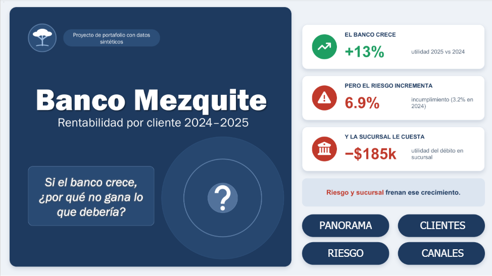
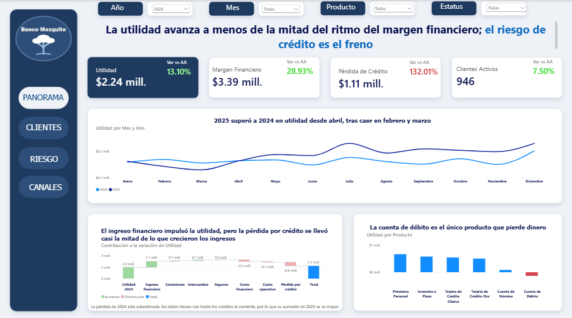
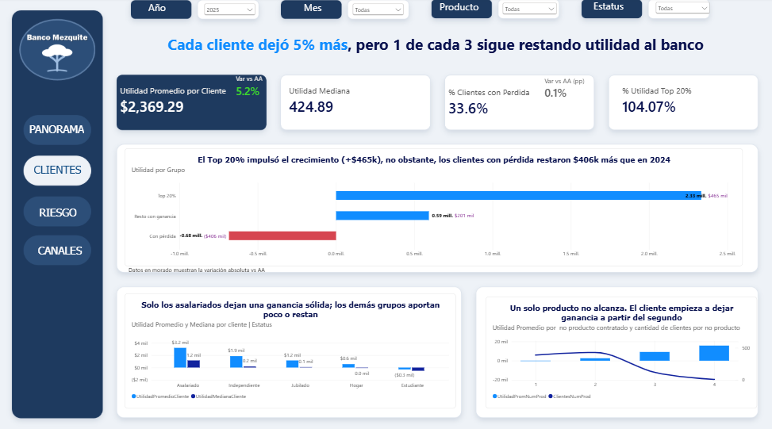
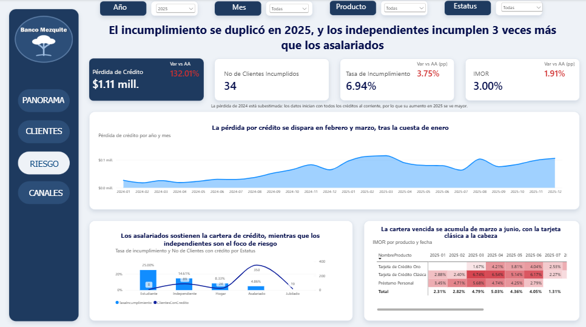
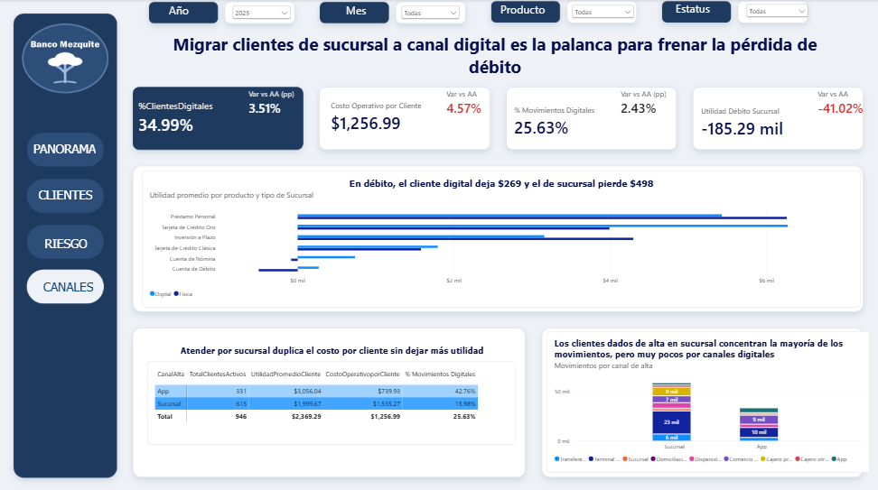
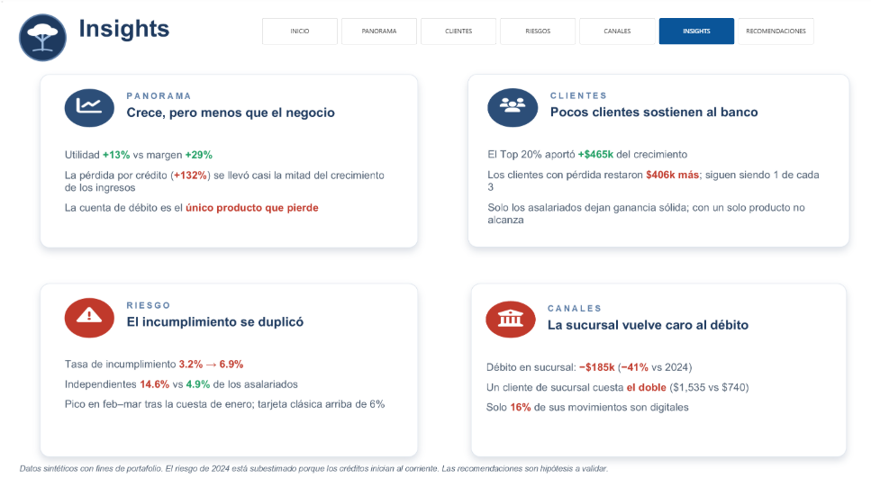
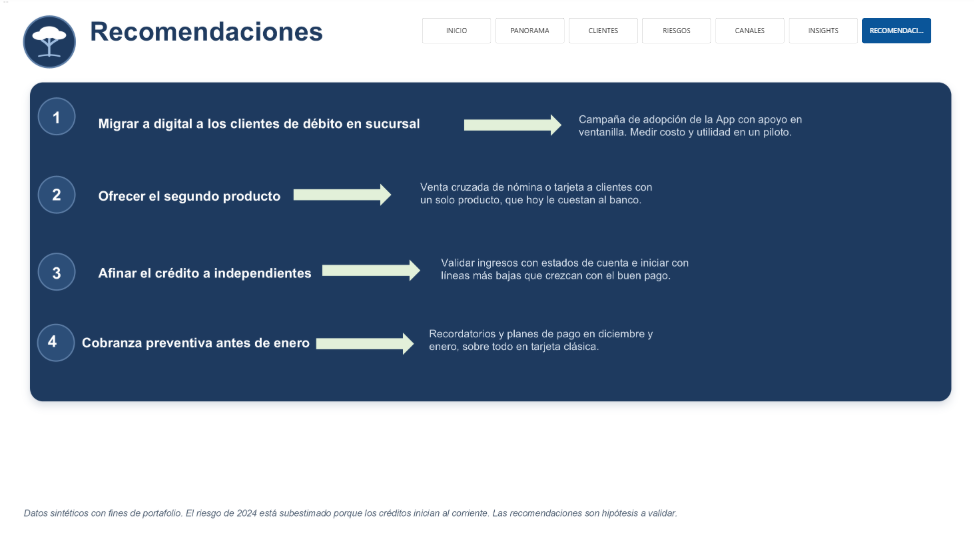
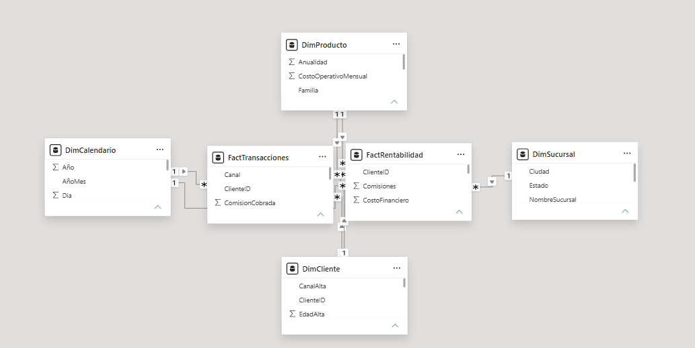

# Banco Mezquite: rentabilidad por cliente 2024–2025
 
**Si el banco crece, ¿por qué no gana lo que debería?**
 
En 2025 la utilidad de Banco Mezquite creció **13%**, pero el margen financiero creció **29%**. Este proyecto busca qué frena la utilidad y dónde está la palanca para recuperarla, analizando la rentabilidad de cada cliente, producto y canal.
 
> Proyecto de portafolio con **datos sintéticos**. Banco Mezquite es un banco ficticio; los datos se generaron con reglas de negocio de la banca en México (tasa de Banxico, cuesta de enero, castigo a 180 días) e incluyen errores sembrados a propósito para practicar la validación.
 

 
**Herramientas:** Excel, Power Query, VBA, SQL Server, Power BI, DAX y PowerPoint.
 
[Ver la presentación completa (PDF)](presentacion/Presentacion_Banco_Mezquite.pdf)
 
---
 
## Hallazgos principales (2025 vs 2024)
 
| | Hallazgo | Dato clave |
|---|---|---|
| **Panorama** | La utilidad crece a menos de la mitad del ritmo del margen | +13% vs +29%; la pérdida por crédito subió 132% |
| **Clientes** | Pocos clientes sostienen al banco | El Top 20% aportó +$465k al crecimiento; 1 de cada 3 clientes resta utilidad |
| **Riesgo** | El incumplimiento se duplicó | De 3.2% a 6.9%; los independientes incumplen 3 veces más que los asalariados |
| **Canales** | La sucursal vuelve caro al débito | El débito en sucursal dejó -$185k (-41% vs 2024); atender a un cliente en sucursal cuesta el doble que en App |
 
## Recomendaciones
 
1. **Migrar a digital a los clientes de débito en sucursal**, con apoyo en ventanilla, midiendo costo y utilidad antes de escalar.
2. **Ofrecer el segundo producto** a clientes con un solo producto, que hoy le cuestan al banco.
3. **Afinar el crédito a independientes**: validar ingresos e iniciar con líneas más bajas que crezcan con el buen pago.
4. **Cobranza preventiva antes de enero**, sobre todo en tarjeta clásica.
---
 
## El dashboard
 
Cuatro páginas, una pregunta cada una. Cada título se comprueba con lo que muestra la página.
 
**1. Panorama: ¿cómo le fue al banco?**

 
**2. Clientes: ¿quién deja ganancia y quién resta?**

 
**3. Riesgo: ¿qué tan grande es el freno?**

 
**4. Canales: ¿dónde está la palanca?**

 
**Insights y recomendaciones**

 
---
 
## Proceso
 
| Etapa | Herramienta | Qué hice |
|---|---|---|
| 1. Validar | Excel, Power Query y VBA | Limpié 6 tablas, mandé a cuarentena los registros sin cliente válido y concilié cada total contra las cifras de control. Una macro exporta las tablas limpias a CSV |
| 2. Analizar | SQL Server | Base con llaves primarias y foráneas, vista de utilidad, CTE, funciones de ventana y percentiles |
| 3. Modelar | Power BI y DAX | Modelo estrella, variaciones contra el año anterior y segmentación dinámica de clientes |
| 4. Comunicar | Power BI y PowerPoint | Títulos que explican qué significa cada dato e historia de 4 páginas |
 
**Validación:** encontré y corregí 8 tipos de error (clientes y filas duplicadas, registros sin cliente válido, fechas fuera de periodo, montos guardados como texto, fechas de nacimiento imposibles, ingresos vacíos y variantes de nombres de estado). La carga final cuadra con las cifras de control: **1,000 clientes, 30,932 registros de rentabilidad y 167,700 movimientos**.
 
**Modelo de datos:** 4 dimensiones (cliente, producto, sucursal y calendario) y 2 tablas de hechos (rentabilidad mensual y transacciones), con relaciones 1 a muchos.
 

 
---
 
## Qué hay en cada carpeta
 
- **datos:** los datos de origen, las cifras de control y las 6 tablas limpias en CSV que genera la macro.
- **excel:** la validación en Power Query, la macro que exporta las tablas a CSV, el diccionario de datos y el análisis complementario con la prueba t.
- **sql:** los scripts numerados en el orden en que se ejecutan.
- **powerbi:** las medidas DAX, organizadas por página del dashboard.
- **presentacion:** la presentación en PDF.
- **Imagenes_dashboard:** las capturas del dashboard.
**Para reproducir el análisis en SQL Server:** ejecuta los scripts de `sql/` en orden (01 al 05). En `02_cargar_datos.sql`, cambia la ruta de los CSV por la carpeta `datos/limpios/` de tu computadora.
 
El archivo de Power BI (.pbix) está disponible a solicitud.
 
---
 
## Limitaciones
 
- Datos sintéticos con fines de portafolio.
- El riesgo de 2024 está subestimado porque los créditos inician al corriente; por eso las variaciones de riesgo contra 2024 se ven mayores.
- Solo dos años de historia; no incluye impuestos ni costo de capital.
- Los hallazgos muestran asociación, no causa. Las recomendaciones son hipótesis a validar.
---
 
## Autora
 
**Brenda Sarahi Santoyo Cordova**
Analista de datos & Licenciada en Business Intelligence
[LinkedIn](https://www.linkedin.com/in/TU-PERFIL)
 
© 2026 Brenda Sarahi Santoyo Cordova. Todos los derechos reservados. Ver [LICENSE](LICENSE).
