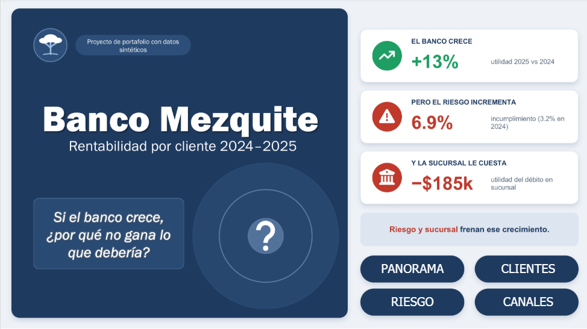
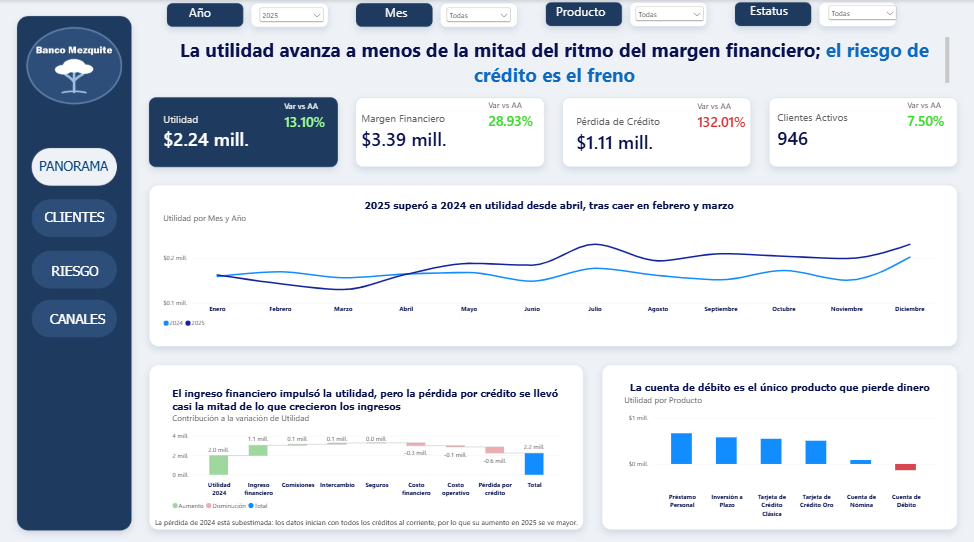
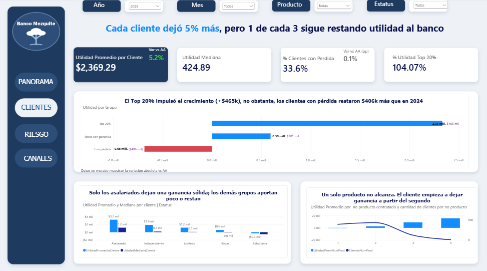
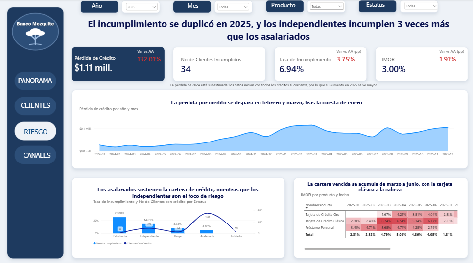
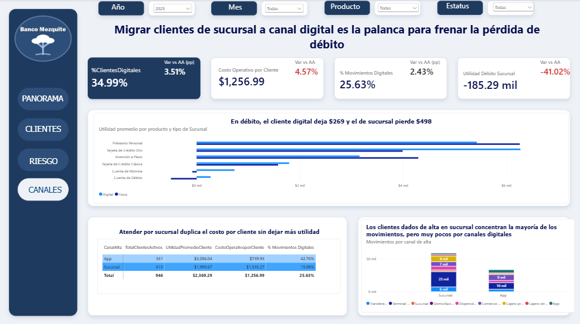
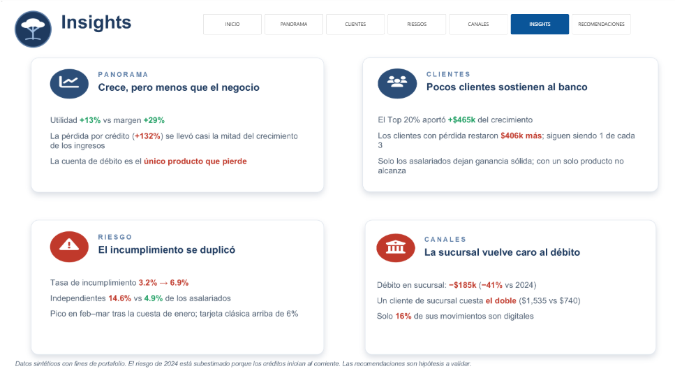
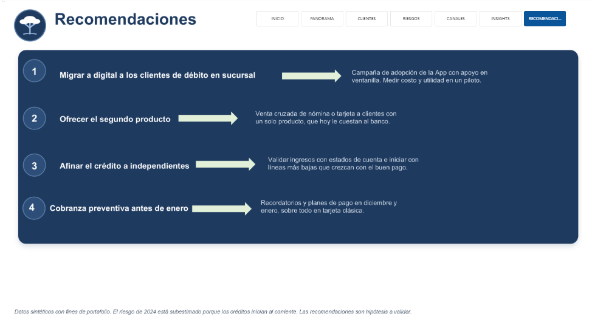
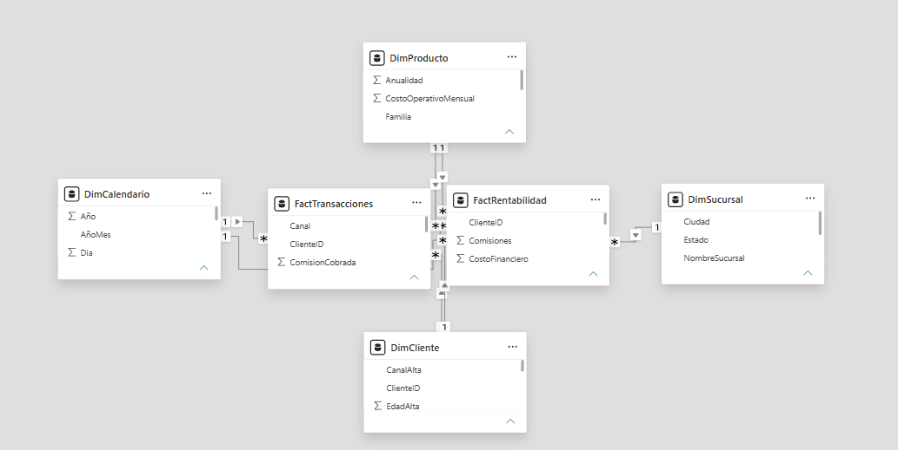

# Banco Mezquite: customer profitability 2024–2025

[Versión en español](README.md)

**If the bank is growing, why isn't it earning what it should?**

In 2025, Banco Mezquite's net profit grew **13%**, while its net interest margin grew **29%**. This project looks for what is holding profit back and where the bank can act, by analyzing the profitability of each customer, product and channel.

> Portfolio project built with **synthetic data**. Banco Mezquite is a fictional Mexican bank; the data was generated with business rules from Mexican retail banking (Banxico reference rate, the January payment slump known as *cuesta de enero*, write-off at 180 days past due) and includes errors planted on purpose to practice data validation. The dashboard and code are in Spanish; amounts are in Mexican pesos.

**Tools:** Excel, Power Query, VBA, SQL Server, Power BI, DAX and PowerPoint.

[Full presentation (PDF, Spanish)](presentacion/Presentacion_Banco_Mezquite.pdf)

---

## Key findings (2025 vs 2024)

| | Finding | Key figure |
|---|---|---|
| **Overview** | Profit is growing at less than half the pace of the margin | +13% vs +29%; credit losses rose 132% |
| **Customers** | A few customers carry the bank | The top 20% added +$465k to profit growth; 1 in 3 customers reduces profit |
| **Risk** | The default rate doubled | From 3.2% to 6.9%; self-employed customers default 3 times more than salaried ones |
| **Channels** | Branches make debit accounts expensive | Debit accounts served in branches lost $185k (-41% vs 2024); serving a branch customer costs twice as much as an app customer |

## Recommendations

1. **Move branch debit customers to digital channels**, with help at the counter, measuring cost and profit before scaling up.
2. **Offer a second product** to single-product customers, who currently cost the bank money.
3. **Tighten credit for self-employed customers**: verify income and start with lower credit limits that grow with good payment behavior.
4. **Preventive collections before January**, especially for the classic credit card.

---

## The dashboard

Four pages, one question each. Every page title can be checked against what the page shows.

**1. Overview (Panorama): how did the bank do?**

**2. Customers (Clientes): who generates profit and who reduces it?**

**3. Risk (Riesgo): how big is the drag?**

**4. Channels (Canales): where can the bank act?**

**Insights and recommendations**

---

## Process

| Stage | Tools | What I did |
|---|---|---|
| 1. Validate | Excel, Power Query and VBA | Cleaned 6 tables, quarantined records without a valid customer and reconciled every total against control figures. A macro exports the clean tables to CSV |
| 2. Analyze | SQL Server | Database with primary and foreign keys, a profit view, CTEs, window functions and percentiles |
| 3. Model | Power BI and DAX | Star schema, year-over-year changes and dynamic customer segmentation |
| 4. Communicate | Power BI and PowerPoint | Titles that explain what each number means and a 4-page story |

**Validation:** I found and fixed 8 types of errors (duplicate customers and rows, records without a valid customer, dates outside the period, amounts stored as text, impossible birth dates, missing income values and inconsistent state names). The final load matches the control figures: **1,000 customers, 30,932 monthly profitability records and 167,700 transactions**.

**Data model:** 4 dimensions (customer, product, branch and calendar) and 2 fact tables (monthly profitability and transactions), with one-to-many relationships.

---

## What's in each folder

- **datos:** source data, control figures and the 6 clean tables in CSV generated by the macro.
- **excel:** Power Query validation, the macro that exports the tables to CSV, the data dictionary and a complementary analysis with a t-test.
- **sql:** scripts numbered in the order they run.
- **powerbi:** DAX measures, organized by dashboard page.
- **presentacion:** the presentation in PDF.
- **Imagenes_dashboard:** dashboard screenshots.

**To reproduce the analysis in SQL Server:** run the scripts in `sql/` in order (01 to 05). In `02_cargar_datos.sql`, change the CSV path to the `datos/limpios/` folder on your computer.

The Power BI file (.pbix) is available on request.

---

## Limitations

- Synthetic data for portfolio purposes.
- 2024 risk is understated because all loans start out current, so year-over-year risk changes look larger.
- Only two years of history; taxes and cost of capital are not included.
- The findings show association, not causation. The recommendations are hypotheses to be tested.

---

## Author

**Brenda Sarahi Santoyo Cordova**

Data Analyst & Business Intelligence graduate

[LinkedIn](https://www.linkedin.com/in/brenda-sarahi-santoyo-cordova-5095101b2)

© 2026 Brenda Sarahi Santoyo Cordova. All rights reserved. See [LICENSE](LICENSE).
